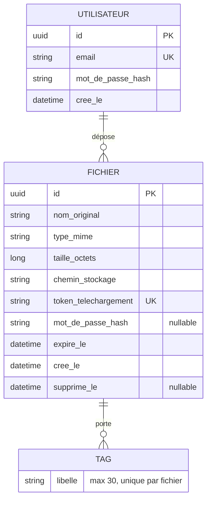

# DataShare - fiche de conception

Faite à partir des spécifications (US01 à US10), du modèle de doc technique et des maquettes Figma.

## 1. Stack technique

| Élément | Choix | Alternatives | Pourquoi |
|---|---|---|---|
| Back-end | Spring Boot 4.1 (Java 21) | .NET Core, NestJS, Symfony/Laravel | Je l'ai déjà utilisé au P2 (Spring Security, JWT, JPA, JUnit, Mockito, JaCoCo). L'upload multipart et le streaming sont gérés de base. |
| Front-end | Vue 3 + Vite 7 + TypeScript (Vue Router, Pinia, Axios) | Angular, React | Plus léger qu'Angular, ce qui aide pour le budget de perf. Un composant = un fichier .vue. TypeScript pour typer les réponses de l'API. J'ai pris Vite 7 et pas 8 car Vite 8 plante sur mon PC (son binaire demande l'AVX2, que mon processeur n'a pas). |
| Base de données | PostgreSQL 16 | MongoDB | Les données sont relationnelles : un utilisateur a des fichiers, un fichier a des tags. L'unicité de l'email et du token est vérifiée par la base. |
| Création des tables | Flyway (`V1__init.sql`) | `ddl-auto: update` | Les tables sont créées par des scripts SQL versionnés, lancés au démarrage du back. Ça sert aussi de script d'installation. |
| Stockage | Disque local (volume Docker) | AWS S3 | Gratuit et facile à montrer en soutenance. Je passe par une interface `StorageService` pour pouvoir brancher S3 plus tard. |
| Authentification | JWT HS256 (jjwt) + BCrypt | Session, OAuth2 | Demandé par US03/US04, et l'API reste sans état. |
| Tests | JUnit 5, Mockito, Testcontainers, JaCoCo, Vitest, Vue Test Utils, Cypress | Jest | Il faut 70 % de couverture minimum et 2 ou 3 scénarios E2E. Vitest reprend la config de Vite. |
| Qualité / sécurité / perf | npm audit, Trivy, k6, Lighthouse | OWASP Dependency-Check | Demandés pour SECURITY.md et PERF.md. |
| Outils | Git + GitHub, Docker Compose, Maven, npm | GitLab | Dépôt public avec des commits conventionnels. |

## 2. Architecture

Le front appelle uniquement le back, et seul le back accède à la base et aux fichiers. `/api/auth/**` et `/api/download/**` sont publiques, le reste demande un JWT.

Comme au P2, le back est découpé en controller / service / repository. Les controllers renvoient des DTO, jamais les entités JPA.

## 3. Modèle de données

### MCD

Un utilisateur peut déposer 0 ou plusieurs fichiers. Un fichier a 0 ou 1 propriétaire : 0 seulement si on fait l'upload anonyme de l'US07, qui est optionnelle. Un fichier peut avoir plusieurs tags (US08, optionnelle aussi).

### Tables (MLD)

| Table | Colonnes | Contraintes |
|---|---|---|
| `users` | `id`, `email`, `password_hash`, `created_at` | `email` unique |
| `files` | `id`, `owner_id`, `original_name`, `mime_type`, `size_bytes`, `storage_key`, `download_token`, `password_hash`, `expires_at`, `created_at`, `purged_at` | `owner_id` vers `users.id` (peut être nul), `download_token` unique, index sur `expires_at` |
| `file_tags` | `file_id`, `label` | clé primaire (`file_id`, `label`), suppression en cascade avec le fichier |

Quelques choix :
- Le `download_token` fait 32 caractères aléatoires (`SecureRandom` en base64url) pour qu'on ne puisse pas le deviner. Le lien de la maquette (`datashare.fr/UhDyr`) est trop court pour ça.
- Le mot de passe d'un fichier est stocké en BCrypt et l'API ne le renvoie jamais.
- L'expiration va de 1 à 7 jours, 7 par défaut.
- Sur le disque, le fichier est enregistré sous un nom aléatoire (`storage_key`), pas sous son nom d'origine.

## 4. Contrat d'interface

Le détail est dans [`docs/openapi.yaml`](openapi.yaml).

| Méthode | Route | Accès | US | Réponse |
|---|---|---|---|---|
| POST | `/api/auth/register` | public | US03 | 201, 400 si email invalide ou mot de passe < 8, 409 si email déjà pris |
| POST | `/api/auth/login` | public | US04 | 200 `{ token, expiresIn }`, 401 si identifiants faux |
| POST | `/api/files` | JWT | US01 | 201 `{ id, downloadUrl, expiresAt }`, 400, 413 si > 1 Go, 415 si extension interdite |
| GET | `/api/files?status=all\|active\|expired` | JWT | US05 | 200, fichiers de l'utilisateur connecté |
| DELETE | `/api/files/{id}` | JWT (propriétaire) | US06 | 204, 404 si inconnu ou fichier d'un autre |
| GET | `/api/download/{token}` | public | US02 | 200 infos du fichier, 404 lien invalide, 410 expiré |
| POST | `/api/download/{token}` | public | US02 | 200 le fichier, 401 mauvais mot de passe, 404, 410 |

Le mot de passe d'un fichier protégé part dans le corps d'un POST et pas dans l'URL, sinon il se retrouverait dans l'historique du navigateur et dans les logs du serveur.

Si quelqu'un essaie de supprimer le fichier d'un autre, il reçoit un 404 et pas un 403, pour ne pas lui confirmer que le fichier existe.

Toutes les erreurs ont le même format `{ status, error, message, timestamp }`, ce qui permet au front d'afficher le message directement.

## 5. Écrans

| Écran | Route front | Contenu |
|---|---|---|
| Accueil | `/` | « Tu veux partager un fichier ? » et le bouton d'upload. Si on n'est pas connecté, on est renvoyé vers `/login`. |
| Connexion | `/login` | Email, mot de passe, lien « Créer un compte », bouton « Connexion ». |
| Création de compte | `/register` | Email, mot de passe, vérification du mot de passe, lien « J'ai déjà un compte ». |
| Ajouter un fichier | modale sur `/` | Fichier (bouton « Changer »), mot de passe optionnel, expiration de 1 à 7 jours, « Téléverser ». Erreur « La taille des fichiers est limitée à 1 Go ». Une fois envoyé : le lien et « Copier le lien ». |
| Mon espace | `/files` | « Mes fichiers » avec les onglets Tous / Actifs / Expiré. Cadenas sur les fichiers protégés, boutons « Supprimer » et « Accéder ». Pour un fichier expiré : « Ce fichier a expiré, il n'est plus stocké chez nous ». En haut : « Ajouter des fichiers » et « Déconnexion ». |
| Télécharger un fichier | `/d/:token` | Nom, taille, « Ce fichier expirera dans N jours », mot de passe si besoin, « Télécharger ». Message d'erreur si le lien a expiré. |
