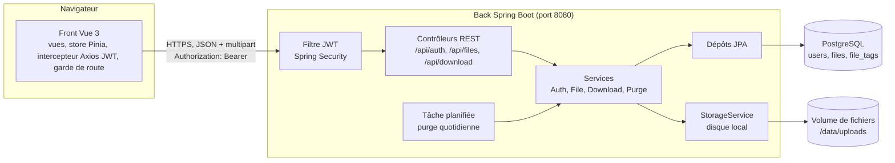
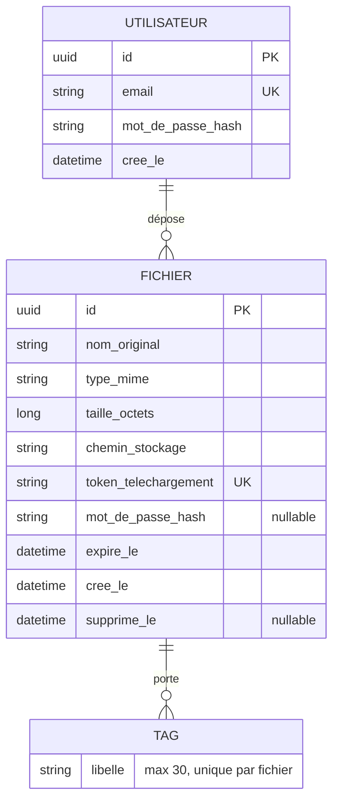

# DataShare — Conception (étape 1)

Sources : spécifications fonctionnelles (US01 à US10), modèle de documentation technique, maquettes Figma (Téléversement, Login, Téléchargement, Mon espace).

## 1. Stack technique

| Élément | Choix | Alternatives proposées | Justification |
|---|---|---|---|
| Back-end | Spring Boot 4.1 (Java 21) | .NET Core, NestJS, Symfony/Laravel | Déjà pratiqué au P2 : Spring Security, JWT, JPA, JUnit, Mockito, JaCoCo. Upload multipart et streaming natifs. |
| Front-end | Vue 3 + Vite 7 + TypeScript (Vue Router, Pinia, Axios) | Angular, React | Plus léger qu’Angular : bundle réduit pour le budget de performance, composants en un seul fichier, démarrage rapide avec Vite. TypeScript garde le typage des échanges avec l’API. Vite 7 plutôt que 8 : le binaire Rolldown de Vite 8 exige l’AVX2, absent du poste de développement. |
| Base de données | PostgreSQL 16 | MongoDB | Données relationnelles : un utilisateur possède des fichiers, un fichier a des tags. Contraintes d’unicité (email, token) en base. |
| Scripts de base | Flyway (`V1__init.sql`) | `ddl-auto: update` | Les tables sont créées par des scripts SQL versionnés, joués au démarrage. Le même script sert d’installation et de documentation. |
| Stockage | Système de fichiers local (volume Docker) | AWS S3 | Gratuit, simple à démontrer. Une interface `StorageService` permet de passer à S3 plus tard. |
| Authentification | JWT HS256 (jjwt), BCrypt | Session, OAuth2 | Exigé par US03/US04. API sans état. |
| Tests | JUnit 5, Mockito, Testcontainers, JaCoCo, Vitest, Vue Test Utils, Cypress | Jest | Couverture ≥ 70 % et 2–3 scénarios E2E exigés. Vitest partage la configuration de Vite. |
| Qualité / sécurité / perf | `npm audit`, Trivy, k6, Lighthouse | OWASP Dependency-Check | Exigés par SECURITY.md et PERF.md. |
| Outils | Git + GitHub, Docker Compose, Maven, npm | GitLab | Dépôt public, conventional commits. |

## 2. Architecture

Légende :
- Flèche pleine : appel synchrone.
- Le front ne parle qu’au back. Le back est seul à accéder à la base et au disque.
- Les routes `/api/auth/**` et `/api/download/**` sont publiques. Toutes les autres exigent un JWT.

Couches du back : contrôleur (entrées/sorties, DTO), service (règles métier), dépôt (données). Aucune entité JPA ne sort d’un contrôleur.

## 3. Modèle de données

### MCD

Cardinalités :
- Un utilisateur dépose 0 à N fichiers. Un fichier appartient à 0 ou 1 utilisateur (0 pour l’upload anonyme US07, optionnel).
- Un fichier porte 0 à N tags (US08, optionnel). Un tag n’existe que sur un fichier.

### Tables (MLD)

| Table | Colonnes | Contraintes |
|---|---|---|
| `users` | `id`, `email`, `password_hash`, `created_at` | `email` unique |
| `files` | `id`, `owner_id`, `original_name`, `mime_type`, `size_bytes`, `storage_key`, `download_token`, `password_hash`, `expires_at`, `created_at`, `purged_at` | `owner_id` → `users.id` (nullable), `download_token` unique, index sur `expires_at` |
| `file_tags` | `file_id`, `label` | clé primaire (`file_id`, `label`), `file_id` → `files.id` avec suppression en cascade |

Règles portées par le modèle :
- `download_token` : 32 caractères aléatoires (`SecureRandom`, base64url). Non prédictible, contrairement à l’exemple court de la maquette (`datashare.fr/UhDyr`).
- `password_hash` du fichier : BCrypt, jamais renvoyé par l’API.
- `expires_at` : entre 1 et 7 jours après `created_at`. Défaut : 7 jours.
- `storage_key` : nom aléatoire sur disque. Le nom d’origine n’est jamais utilisé comme chemin.

## 4. Contrat d’interface

Spécification complète : [`docs/openapi.yaml`](openapi.yaml).

| Méthode | Route | Accès | US | Réponse |
|---|---|---|---|---|
| POST | `/api/auth/register` | public | US03 | 201, 400 email invalide ou mot de passe < 8, 409 email déjà pris |
| POST | `/api/auth/login` | public | US04 | 200 `{ token, expiresIn }`, 401 identifiants faux |
| POST | `/api/files` | JWT | US01 | 201 `{ id, downloadUrl, expiresAt }`, 400, 413 > 1 Go, 415 extension interdite |
| GET | `/api/files?status=all\|active\|expired` | JWT | US05 | 200 liste des fichiers du propriétaire |
| DELETE | `/api/files/{id}` | JWT propriétaire | US06 | 204, 404 inconnu ou fichier d’un autre |
| GET | `/api/download/{token}` | public | US02 | 200 métadonnées, 404 lien invalide, 410 expiré |
| POST | `/api/download/{token}` | public | US02 | 200 flux binaire, 401 mot de passe faux, 404, 410 |

Choix du contrat :
- Le mot de passe d’un fichier protégé est envoyé dans le corps d’un `POST`, jamais dans l’URL. Il n’apparaît donc ni dans l’historique du navigateur ni dans les logs.
- `DELETE` d’un fichier d’un autre utilisateur renvoie 404, pas 403. On ne révèle pas l’existence du fichier.
- Erreurs au format commun `{ status, error, message, timestamp }`, pour afficher un message clair à l’écran.

## 5. Écrans (d’après les maquettes)

| Écran | Route front | Contenu |
|---|---|---|
| Accueil | `/` | « Tu veux partager un fichier ? », bouton d’upload. Sans connexion, renvoie vers `/login`. |
| Connexion | `/login` | Email, mot de passe, lien « Créer un compte », bouton « Connexion ». |
| Création de compte | `/register` | Email, mot de passe, vérification du mot de passe, lien « J’ai déjà un compte ». |
| Ajouter un fichier | modale sur `/` | Fichier, bouton « Changer », mot de passe (optionnel), expiration (1 à 7 jours), « Téléverser ». Erreur « La taille des fichiers est limitée à 1 Go ». Succès : lien et « Copier le lien ». |
| Mon espace | `/files` | « Mes fichiers », onglets Tous / Actifs / Expiré, ligne avec cadenas si protégé, « Supprimer », « Accéder ». Fichier expiré : « Ce fichier a expiré, il n’est plus stocké chez nous ». Boutons « Ajouter des fichiers » et « Déconnexion ». |
| Télécharger un fichier | `/d/:token` | Nom, taille, « Ce fichier expirera dans N jours », mot de passe si protégé, « Télécharger ». Lien expiré : message d’erreur. |
